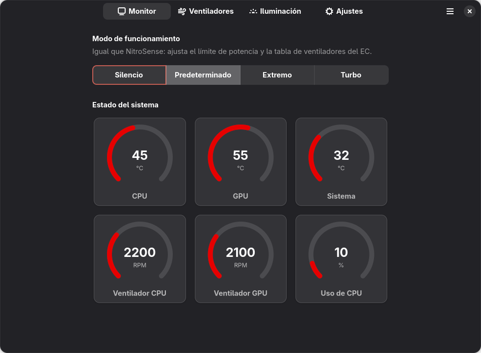
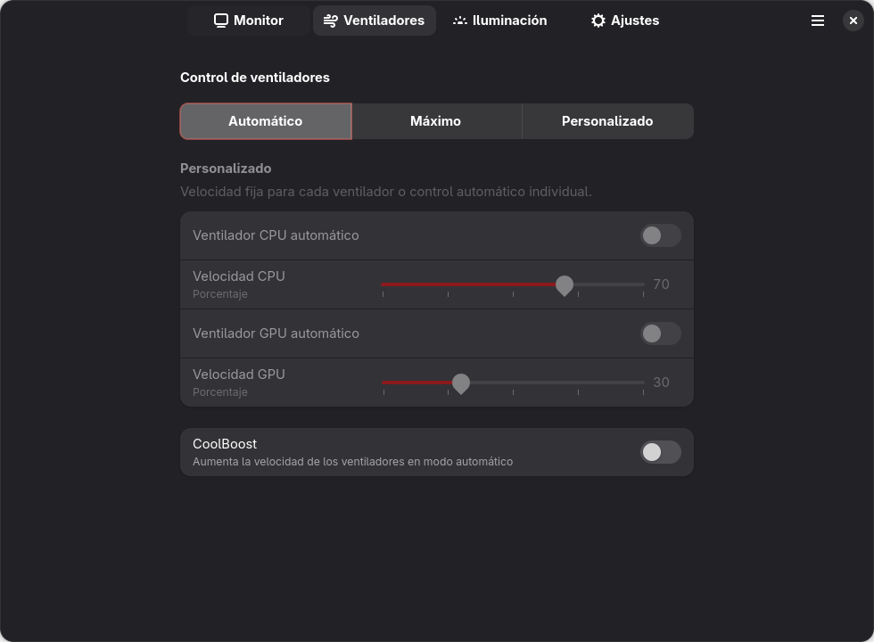

<div align="center">


# Acer NitroSense para Linux

**Control de ventiladores, modos de rendimiento, CoolBoost y teclado RGB para portátiles Acer Nitro — en Linux.**


[English](README.md) · **Español**

</div>

| Monitor | Ventiladores |
|:-:|:-:|
|  |  |

## Funciones

- Temperaturas y velocidad de los ventiladores (CPU, GPU, sistema)
- Modos de funcionamiento: Silencio, Predeterminado, Extremo, Turbo
- Ventiladores: Automático, Máximo o velocidad personalizada por ventilador, y CoolBoost
- Teclado RGB: estático 4 zonas, respiración, neón, ola, desplazamiento, zoom
- Modos de iluminación dinámicos extra: Termómetro, Aurora, Carga de CPU, Brasas
- Apagado de la retroiluminación, bloqueo de la tecla Windows, LCD Overdrive
- Los ajustes se reaplican al arrancar y al volver de la suspensión

## Probado en

| Portátil | Estado |
|----------|--------|
| Acer Nitro 5 **AN515-57** | ✅ Funciona |
| Otros Acer Nitro / Predator | ❓ Sin probar |

Otros modelos pueden funcionar si tienen la misma interfaz de firmware. Compruébalo con:

```bash
ls /sys/bus/wmi/devices/ | grep -i 7A4DDFE7-5B5D-40B4-8595-4408E0CC7F56
```

Si muestra algo, puedes probar a instalar con `--force` (bajo tu responsabilidad). Abre un
[issue](https://github.com/Sunshide12/Nitrosense-for-linux/issues) para contar si funcionó
en tu modelo.

## Instalación (Fedora)

```bash
sudo dnf upgrade --refresh        # reinicia después si se actualizó el kernel
git clone https://github.com/Sunshide12/Nitrosense-for-linux.git
cd Nitrosense-for-linux
sudo bash install.sh
```

- **Secure Boot:** el instalador te pide una contraseña temporal. Reinicia y en la pantalla
  azul de *MOK management* elige **Enroll MOK → Continue → Yes** e introdúcela. Solo una vez.
- **Cierra sesión y vuelve a entrar**, y abre **NitroSense** desde el menú de aplicaciones.

Para desinstalar: `sudo bash uninstall.sh` (con `--purge` borra también los ajustes).

## Uso

Abre **NitroSense** desde el menú de aplicaciones, o usa la línea de comandos:

```bash
nitrosense-ctl status                    # temperaturas, ventiladores y ajustes
nitrosense-ctl mode turbo                # quiet | default | extreme | turbo
nitrosense-ctl fan max                   # auto | max | custom
nitrosense-ctl fan custom --cpu 70 --gpu auto
nitrosense-ctl coolboost on
nitrosense-ctl kb static --brightness 100 --zones ff0000 00ff00 0000ff ffffff
nitrosense-ctl kb wave --speed 5 --brightness 75
nitrosense-ctl light thermal             # thermal | aurora | load | ember | off
```

`nitrosense-ctl --help` muestra todas las opciones.

## Cómo se hizo

NitroSense de Acer es una aplicación .NET solo para Windows que habla con la BIOS a través
de un servicio de Windows y WMI, así que no se puede recompilar para Linux. Su protocolo se
obtuvo por ingeniería inversa (la aplicación, su servicio y las tablas ACPI del portátil) y
se reimplementó desde cero:

- `kernel/` — un driver WMI para Linux (compilado con DKMS) que habla con la BIOS
- `app/` — la aplicación GTK4 / libadwaita y la herramienta `nitrosense-ctl`

El protocolo está documentado en [PROTOCOL.md](PROTOCOL.md) y las herramientas usadas en
[`re-tools/`](re-tools). No se incluye código ni binarios de Acer.

## Licencia

Copyright (C) 2026 Steban Martínez Gutiérrez (Sunshide.com). Software libre bajo la
[GNU GPL v2 o posterior](LICENSE) (`GPL-2.0-or-later`): puedes usarlo, estudiarlo, modificarlo
y compartirlo; si lo distribuyes (modificado o no) debes mantener los avisos de copyright y la
licencia, y publicar tus cambios bajo la misma licencia.

**Aviso sobre el hardware:** este software escribe en el firmware de tu portátil (ventiladores,
modos de rendimiento). No ofrece garantía alguna, como indica la licencia; úsalo bajo tu
responsabilidad.

NitroSense es una marca de Acer Inc. Este es un proyecto independiente, sin afiliación,
respaldo ni patrocinio de Acer.

Las contribuciones son bienvenidas, consulta [CONTRIBUTING.md](CONTRIBUTING.md).
